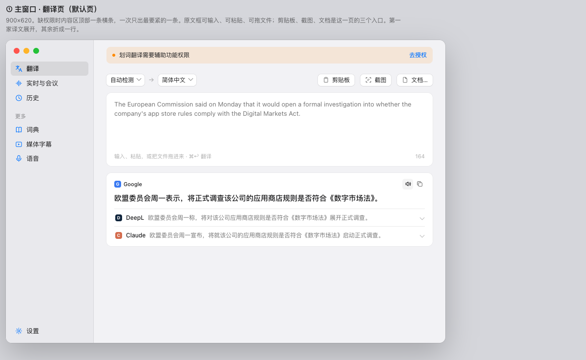

English | [中文](README.zh-CN.md)

# Korgino

A translation app for macOS. Select text and it translates. Live captions follow the system audio or the microphone. Drop in a file and read the original next to the translation.

Windows is the same product. That build is not usable yet.

## Use

macOS 15 or later.

1. Download the disk image from [Releases](https://github.com/sliiu/korgino/releases).
2. Open it and drag Korgino into Applications.

These builds are ad-hoc signed and not notarized. The first time you open the app, allow it in System Settings.

To build it yourself, run `./build.sh` on a Mac with the Swift toolchain and the macOS SDK. It compiles a universal app and installs it into `~/Applications`.

## What it does

- **Selection.** Select text in another app. The translation overlay shows the original and each translation, and can write the result back over the selection.
- **Live captions.** System audio or the microphone, translated as it is spoken. Finished segments can be saved as text.
- **Files.** Drop in text, PDF, Word, Excel, PowerPoint, or an image. The original and the translation sit side by side.
- **Screenshot.** Select a region of the screen. The app reads the text and translates it.

A short film of the overlay, screenshot translation, and live captions: [docs/promo/korgi-launch.mp4](docs/promo/korgi-launch.mp4).

## License

[AGPL-3.0-or-later](LICENSE). Copyright holder: Sliiu Inc. See [COPYRIGHT](COPYRIGHT). Embedding this in a closed-source program needs a commercial license. See [COMMERCIAL.md](COMMERCIAL.md).

Third-party notices are in [THIRD-PARTY-NOTICES.md](THIRD-PARTY-NOTICES.md). Speaker separation uses code and a model that stay under their own licenses.

## Sponsor

