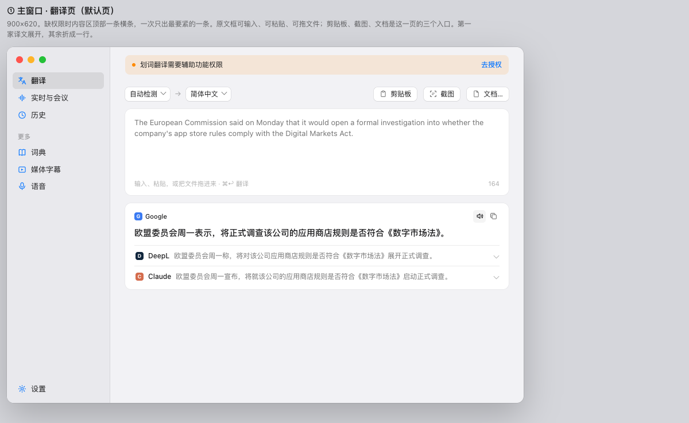
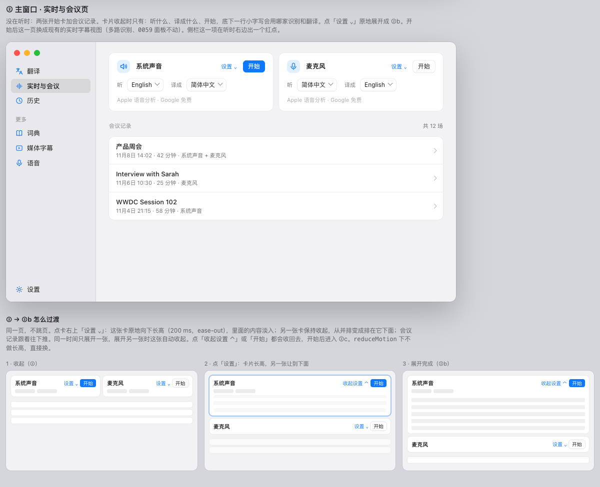

# Korgino

### 选中，即译。

**正在播放的声音，边说边出字幕。文件拖进来，对照看。** 
macOS 上的翻译应用。选中的字当场译出来， 
电脑里正在响的声音跟着出字幕。

   

**[下载](https://github.com/sliiu/korgino/releases/latest)** &nbsp;·&nbsp; **[赞助](#赞助)** &nbsp;·&nbsp; [English](README.md) · **简体中文**

 

 

## 适不适合你

系统的实时字幕把正在播放的声音转成字，不翻译。菜单栏翻译要等你先选中一段。Korgino 两件都做：

- **划词。** 在别的应用里选中文字，翻译浮层里是原文和各家译文。写回盖回当时的选区。
- **实时字幕。** 听系统声音或麦克风，边说边出译文。已经译完的段可以存成文本。
- **文件。** 拖进文本、PDF、Word、Excel、PowerPoint 或图片，原文和译文并排。
- **截图。** 框一块屏幕，认出字，再翻译。

你在 Mac 上读到或听到别的语言，想当场看成自己的，就适合。Windows 版是同一个产品，现在还不能用。

## 使用方式

**1 · 安装。** 从 **[Releases](https://github.com/sliiu/korgino/releases/latest)** 下载磁盘镜像，把 Korgino 拖进「应用程序」。

需要 macOS 15 或更高。现在的安装包是临时签名，没有公证。第一次打开时，macOS 会要求在系统设置里允许。

**2 · 翻译。** 在任何应用里选中文字，或者粘进窗口。打开的每一家服务各出一张卡。

**3 · 听。** 打开「实时与会议」，选系统声音或麦克风，按开始。字幕跟着说出来的话出现。

自己编译：在装了 Swift 工具链和 macOS SDK 的 Mac 上运行 `./build.sh`。它编出一个通用应用，装进 `~/Applications`。`./build.sh --release` 打的是发布包，不覆盖 `~/Applications`。

## 能做什么

### 划词

在别的应用里选中文字。浮层里是原文，每一家服务一张卡，译文可以盖回当时的选区。短词旁边可以带一条释义。

### 实时字幕

系统声音和麦克风各一张卡。两路可以一起听，记成同一场会议记录。译完的段可以导出成文本。

### 文件和截图

把文件拖进窗口，或者选一个。文本、PDF、Word、Excel、PowerPoint 和图片都是原文在一边、译文在另一边。截图翻译读你框出来的那一块里的字。

翻译浮层、截图识别和实时字幕的一段短片：[docs/promo/korgi-launch.mp4](docs/promo/korgi-launch.mp4)。

## 开源协议

[AGPL-3.0-or-later](LICENSE)。版权人是 Sliiu Inc，见 [COPYRIGHT](COPYRIGHT)。闭源嵌入需要商业授权，见 [COMMERCIAL.md](COMMERCIAL.md)。

第三方组件见 [THIRD-PARTY-NOTICES.md](THIRD-PARTY-NOTICES.md)。声纹分说话人用的代码和模型仍按它们自己的许可证，不改成 AGPL。

## 赞助

